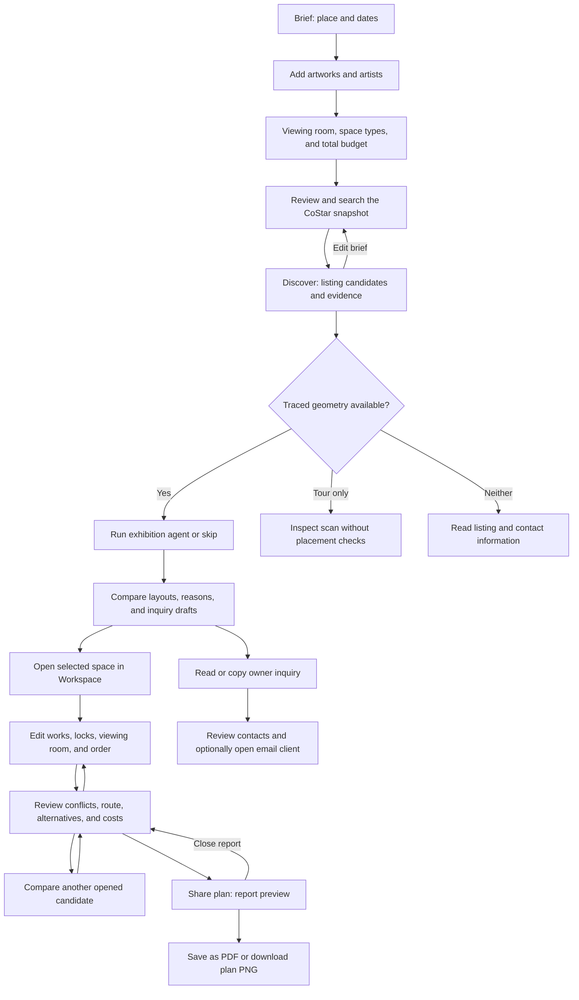

# ArtFit — Project Overview and User Flow

**Edition:** Final source-reviewed document, November 14, 2026.

**Language:** English.

**Source:** The local working tree at `/Users/hyeseung/work/artfit`, including uncommitted changes.

**Scope:** Implemented user journeys, their data handoffs, and explicit implementation limits. “Final” describes this document edition, not a claim that all proposed product features are complete.

**Verification:** Source review. Previous API/test observations are not presented as a fresh full browser, AI, or PDF-export rehearsal.

## 1. Project overview

ArtFit is an exhibition planner for installation artists and organizers preparing a show together. It connects commercial-space listing information with traced spatial geometry so an organizer can test multiple artists' works in one space, revise the visitor journey, and produce a plan for discussion with collaborators and a venue.

The organizer creates **one exhibition brief with one or more artworks**. ArtFit searches a CoStar data-kit snapshot. Its visible exhibition agent can inspect candidates, test the whole show, compare supported results, and draft questions about unresolved venue conditions. The selected layout opens in a Workspace with manual and natural-language editing, route previews, and report export.

The current installation model is floor-standing work, represented for calculation by its outer rectangular footprint and height. Photos and imported GLB models change its appearance; they do not replace the footprint calculation with mesh-level collision detection.

“Group show” means several artists' works in one exhibition plan. Real-time editing by several signed-in users is not implemented.

### 1.1 Main interaction

> Define the exhibition → add its artworks → search real listing records → inspect and compare candidate spaces → open a proposed layout → lock, move, and rearrange works → preview the visitor route → export a plan and prepare venue questions.

### 1.2 Responsibilities

| Layer | Role |
| --- | --- |
| CoStar snapshot | Listing identity, availability information, area, asking-rate context, property/tenancy records, contacts, and model associations. |
| Matterport and annotations | Visual context and the traced floor, entrance zones, obstacles, and any recorded local measurements. |
| ArtFit geometry engine | Placement, collision, viewing-room distances, sampled layout suggestions, and route connectivity. |
| Claude through Anthropic API | Tool selection and comparison for the exhibition agent; supported Workspace operations; report narrative. |
| Organizer | Artwork dimensions, acceptable requirements, final layout choices, cost entries, and decisions about inquiries or exports. |

## 2. End-to-end journey

The agent is optional. The featured traced-space section is revealed after its result, **Skip, show the spaces**, or a stale-brief state. The wider catalogue also remains available. A tour-only candidate does not gain placement capability merely because it opens in Workspace.

The three main screens remain **01 Brief → 02 Discover → 03 Workspace**. Contacts and the plan report are additional surfaces, not extra onboarding screens.

## 3. Screen 01 — Brief

### 3.1 Entry and shared project

The introduction offers **Begin your brief** and **Use example exhibition**. The example contains three works and sample requirements; it is not a venue quote or evidence about physical conditions.

One organizer completes the same six steps for a solo work or a group show:

| Step | Input and interaction | Meaning |
| --- | --- | --- |
| 01 Place | Select Houston or Los Angeles. Cards load listing, tour, and traced-plan counts through `GET /api/markets`; selecting a market advances to Dates. | Research markets include surrounding cities. They are not exact city boundaries. |
| 02 Dates | Enter opening and closing dates; optional duration shortcuts update the closing date. | A requested period, not a reservation. Snapshot-to-exhibition timing is shown as context. |
| 03 Artworks | Add, edit, or remove works. | Each work retains its own identity, artist, title, and real dimensions. |
| 04 Room to walk | Set preferred clearance and an optional acceptable minimum. | A viewing-room preference, not an automatically assumed safety or legal standard. |
| 05 Setting | Choose commercial-space types and an optional total exhibition budget. | Shared venue preferences and a total covering venue, transport, installation, and other entered costs. |
| 06 Review | Inspect common inputs and each work; return to the relevant step to edit. | The complete brief submitted to search. |

Current demo annotations are for Houston candidates. The market screen uses runtime counts and explains the tour-browsing limitation when Los Angeles has no traced plan. This is a data-coverage limitation, not a permanent prohibition on Los Angeles layouts.

### 3.2 Artworks

**+ Add artwork** creates another editable row. **Edit** opens its title, artist, width, depth, and height; **Done** closes the row. Onboarding allows **Remove** while at least one other work remains.

- Width, depth, and height must be positive and are entered in meters.
- Titles and artist names can be blank in onboarding; fallback labels are used later.
- A new work receives an internal ID, editable dimensions of 1 × 1 × 1.5 m, and the preceding row's artist name. These defaults are not measurements.
- The count of artists comes from distinct nonblank entered names, not user accounts.
- Combined width × depth is a footprint reference. It does not include all spatial constraints and is not a group-fit result.
- Files are optional. Artwork photos and GLB models can be attached later in Workspace, including separately for group works.

The search validator accepts 1–12 works. The add controls do not consistently enforce that limit before submission; see Section 13.

### 3.3 Shared and individual conditions

Market, dates, space preferences, total budget, and the default viewing-room distance belong to the exhibition. Work identity, dimensions, required/optional status, and viewing-room exceptions belong to an individual work.

Works start as required. A per-work clearance of `null` initially uses the shared preferred clearance. Workspace resolves that default into its work specification; it is not a continuously linked override after every subsequent brief edit.

The optional minimum supports compromise proposals in the existing **single-work** alternatives service. The group planner does not automatically relax every work's viewing room to that minimum.

### 3.4 Search submission

Review shows every artwork and the shared requirements. Submission calls `POST /api/spaces/search`. Success opens Discover. Search failure keeps the current answers and displays an error.

The availability note distinguishes a marketed listing from physical vacancy, an unfurnished condition, or exhibition readiness.

## 4. Data meaning and preliminary candidate search

### 4.1 Facts that remain separate

| Question | Evidence required | What the current listing/scan alone cannot prove |
| --- | --- | --- |
| Is it marketed as available? | Recorded listing status and availability information, with snapshot context. | Current physical vacancy, date-specific booking availability, or permission. |
| Is it physically vacant? | Separate scoped, dated occupancy evidence. | No tenancy row or long time on market is not proof of vacancy. |
| Is it furnished or unfurnished? | Reviewed furnishing observations or other supporting evidence. | A listing's suite category does not establish furnishing condition. |
| Is the intended installation region cleared? | Evidence about that specific region and relevant time. | Vacancy, an unfurnished label, or a hypothetical furniture-removal scenario does not establish a cleared region. |
| Does this layout meet the tested spatial conditions? | Correct suite-to-scan match, adequate geometry/scale/coverage review, and the appropriate calculation. | A linked tour or successful draft calculation is not an installation certificate. |

The kit has no direct commercial-space vacancy, furniture, or cleared-state fields that establish those physical conditions. Missing values remain unknown. The strict verified-condition flags are currently forced to false by server validation.

A Matterport association may be at building level. Exact-suite/region review is a separate application-level step. The existing geometry verification types and `spatiallyVerified` flag must not be confused with an agent's **Recommended**, **Possible**, or **Not recommended** ranking.

### 4.2 What search does

The application reads the local **November 2026 CoStar data-kit snapshot**, not live CoStar inventory. Runtime counts describe space/listing records, not independently confirmed unique vacant venues.

The search:

1. Normalizes listing, nested-space, property, tenancy, model-association, and available contact data.
2. Selects eligible marketed records in the chosen research market.
3. Applies space-use preferences, excludes lease-pending records, and excludes explicit availability dates after the requested opening.
4. Keeps relative or missing dates visible as uncertain. The opening-date comparison does not confirm availability throughout the closing date or installation period.
5. Uses the largest-footprint work and shared clearance for an advertised-area screen.
6. Uses the tallest work for property-level listed-ceiling context.
7. Orders candidates using the area category, height context, long-idle signal, time on market, and a stable ID tie-breaker.

Area and height context affect ordering, not exclusion. Rounded advertised area is neither proof of fit nor proof of impossibility. Largest footprint and tallest height may belong to different works. Per-work viewing rooms, all bodies together, and routes require the group calculation later.

The total budget is carried through the brief but is not a verified cost filter. Asking rents retain their rate bases and must not be presented as short-term exhibition quotes.

## 5. Screen 02 — Discover and the exhibition agent

### 5.1 Catalogue

Discover shows readable runtime summaries, the exhibition's work count, the largest-work screening explanation, and current condition/evidence labels. **How these spaces were selected** exposes the filtering details rather than placing internal stage letters in the main summary.

The wider catalogue offers **All spaces**, **With a 3D tour**, and **Traced geometry**, with incremental loading. Clicking a space name opens its information/contact dialog.

### 5.2 Visible group-show planning

When traced candidates exist and the brief is not stale, **Find the best space** starts `POST /api/agent/show`. A streamed response displays planning notes, tool activity, timing, results, and errors. The user can inspect completed steps or skip the agent.

The visible exhibition agent has its own four tools:

| Tool | Current responsibility |
| --- | --- |
| `search_spaces` | Search using the validated exhibition brief and return candidate, coverage, and work information. |
| `inspect_space` | Read listing facts, condition labels, geometry/matching status, height context, and missing checks. |
| `plan_group_layout` | Test all works together in one traced space using a room-first or route-first strategy. Return placements, required-work counts, spare room, route, issues, visitor estimates, and height facts. |
| `draft_inquiry` | Render questions selected from supported topics using this exhibition's facts and unresolved conditions. |

The agent is instructed to search, inspect traced candidates, try room-first layouts, retry a different strategy when useful, draft relevant questions, and return a ranking. The tool loop is bounded at 14 model turns; partial results or failures do not establish that every possible candidate or arrangement was evaluated.

The validated brief supplies works, sizes, viewing requirements, market, and dates. Group calculations preserve work dimensions and retain unplaced works as reported items. Tool output, not free-form model text, supplies numeric results.

### 5.3 Recommendation and verification

The model returns structured space IDs, verdicts, and allowed reason codes. The server renders supported reasons from the collected tool results and records rejected reasons. The selected layout for a ranked space is attached from stored computed layouts; it is not a set of coordinates invented in the final narrative.

Cards can show **Recommended**, **Possible**, or **Not recommended**, reasons, the returned layout preview, **Read the inquiry**, and **Copy owner inquiry**. These verdicts compare tested planning options. They do not confirm vacancy, local ceiling clearance, legal capacity, price, or permission.

The current recommendation guard downgrades a recommended space when its stored best layout misses required works. It is not a complete gate over every issue, unknown route, local-height condition, and review flag. “Fact-checked” here means specific structured checks; it is not universal verification of the recommendation.

Without AI configuration, tools run in a fixed order and the response is labeled deterministic. Model interruption, an unusable final response, or the turn limit can also produce a deterministic ranking from results already gathered. That is distinct from a completed autonomous model run.

### 5.4 Open a candidate

| Resource state | Available action and boundary |
| --- | --- |
| Traced geometry | Open Workspace with the exhibition and, if available, agent-returned poses. Draft/review status remains visible. |
| Linked tour without traced geometry | Open a tour-only Workspace; no placement verdict. The tour may show the building rather than the exact unit. |
| Neither | Review listing/contact information; no spatial calculation yet. |

Opening a traced card places that candidate first and includes other traced candidates from the results for comparison. The main section can open all traced candidates together. A/B letters describe tab order, not fixed venue identities or quality.

The agent's returned poses are passed through `agentLayoutsOf()` and application state to Workspace. **The current handoff carries poses, not an entire saved exhibition document:** agent-selected visiting order, narrative, inquiries, costs, and revision provenance are not all transferred with those poses. Workspace can recompute its suggested route.

## 6. Screen 03 — Workspace

### 6.1 Arrival and planning modes

Workspace receives the brief, opened candidate IDs, and optional initial agent layouts. It loads candidate inspection and annotation data.

- Multiple incoming works select **Group show**; one selects **Single work**.
- Agent poses initialize the per-space group layout for matching work IDs, with no imported locks.
- With geometry available, the automatic-placement helper attempts unplaced works. Existing placed works remain fixed for that attempt. Failed works stay listed as unplaced.
- Switching candidate tabs within the mounted Workspace keeps separate poses and locks for each candidate. Work specifications, viewing order, and the cost list are shared.
- A linked scan without traced geometry opens as a tour-only view and does not enable a placement result.

The single-work and group editors remain separate state paths. Switching modes is not a guarantee that every aspect of one editor's state is synchronized with the other.

### 6.2 Artworks panel

**Artworks** is the single panel name. The flat list shows title, artist, real dimensions, lock state, optional state, and unplaced status, with artist colors for recognition.

Selecting a group work exposes its dimensions, per-work viewing room, **Must be in the show**, appearance upload, movement/rotation controls, and **Lock position**. Explicit removal requires confirmation and removes that work's poses, locks, order entry, and linked cost items.

**+ Add artwork** also works in Workspace. Its current add form requires title and artist, unlike onboarding's optional names. New works are considered by the automatic-placement helper without automatically moving existing placed works.

Users may edit real dimensions. Group AI and automatic planning do not resize or delete a work to make a result succeed. Marking a work optional permits a suggestion to leave it unplaced; it does not remove it from the exhibition.

### 6.3 Views and direct manipulation

The view labels are **3D plan**, **Compare views**, and **Scan**.

- The plan reconstructs traced geometry and displays artwork geometry, viewing zones, and the route.
- The Matterport integration overlays planned objects in the original scan. It does not rebuild the baked room or prove present-day conditions.
- Works can be dragged in the planning view, subject to lock handling. Resulting conflicts remain visible; a manual move is not automatically guaranteed valid.
- The in-view **Move** pad can select/cycle works, move relative to the current view by 10 or 50 cm, rotate by 15°, and lock/unlock group works. Arrow keys and bracket rotation work while focus is in the pad.
- **Click to place** uses an available scan intersection; in plan mode the pad instead directs users to dragging. Currently the pad disables movement/placement for unplaced or locked works, so it is not a general manual placement path for every unplaced work.
- Explicit group selections can focus the scan camera near the selected work. Scan views are kept mounted for opened candidates during the Workspace session.

Desktop panels and the AI dock reserve layout space around/below the viewer. Panel buttons remain in the top toolbar; panel arrows also close them. The AI input can collapse without discarding its draft. The Move pad is still a floating control inside the viewer. Panel drag resizing is not implemented.

At narrower widths, the dock and panels flow below the fixed-height viewer. Closed panels remain closed; this is not a separate saved mobile layout.

### 6.4 Photos and GLB models

Each selected group work can have a front photo or a GLB model, and both renderers receive the corresponding appearance data. Drag/drop targets the selected group work or the current fallback work identified by the interface.

A photo is applied to the box face. A GLB replaces the display geometry and is scaled to the work's dimensions; the underlying checks still use the outer box. Single-work importing additionally offers model-dimension/proportion handling. Appearance import does not establish measured scale or installation suitability.

Group appearance data is held separately from the group document's Undo/Redo history. Do not promise that Undo restores imported files or that assets survive navigation/reload. Image-to-3D generation is not implemented.

### 6.5 Layout panel

The group panel keeps **Layout** as its title. The current placement status, count placed, **Review pending**, actual conflicts, and relevant unplaced-work messages remain visible.

The main interaction is **Route**, its suggested/custom order, and **Walk route**. Users can reorder works or choose **Reset order** to return to the computed suggestion.

Secondary information uses disclosures: **By artist**, **Layout options**, **Budget**, and **Visitor estimate**. A collapsed disclosure does not convert unknown evidence into a confirmed result.

## 7. Group placement, routes, and alternatives

### 7.1 Placement calculation

Each placed rectangle must remain inside the floor and avoid active blockers and other work bodies. Viewing zones may overlap one another, but another work's body must not occupy a work's required viewing room. Required works without a pose are reported.

The default group suggestion search uses a 0.3 m grid at 0° and 90°, with seeded randomized greedy restarts. It offers tested suggestions, not a guaranteed globally optimal packing. Failure to find a layout is not proof of impossibility.

The separate single-work engine samples a 0.10 m grid, normally at 0°/90°, with an optional four-orientation setting. Display rounding and sampled-clearance rules must not be confused with group-search settings or measurement accuracy.

The current user scenario is **as scanned**. Annotation categories distinguish permanent obstacles, reviewed movable furniture, and uncertain objects. All applicable traced blockers remain included; hypothetical furniture removal is not enabled in the normal UI. Removing a planning blocker would not establish actual removal permission/completion or edit the scan mesh.

### 7.2 Route and playback

The route uses a 0.2 m walkable grid, a 0.25 m person-radius assumption, artwork bodies, and annotated blockers. Entrance zones block artworks but allow walking. The route starts near the first traced entrance, visits computed standing spots, and returns to the same entrance; it does not validate a distinct exit or a load-in path.

Without a user-set order, the algorithm compares permutations for up to seven remaining visitable works using grid-path distances; above that it uses a nearest-next heuristic. The result concerns the selected standing points and grid model, not a globally optimal real visitor experience. A full user order is respected; unset remaining works can be appended by the route logic.

Missing/unconnected entrances and unreachable viewing spots are reported. **Walk route** animates a route preview in the plan and uses available captured viewpoints in the scan, which only approximate continuous travel.

**Known limit:** when no route is available, per-work `reachable` may be `null`. `evaluateGroup().ok` currently rejects explicit false reachability but accepts null. Therefore no placement conflicts is not proof that route connectivity was confirmed. No visitor, fire-safety, accessibility, or structural approval follows from this preview.

### 7.3 Suggested and alternative layouts

Workspace suggestions can prioritize **Most room around each work**, **Follows your viewing order**, or **Fewest changes to the current layout** when applicable. Cards identify required/total placements, spare room, route length when available, locked/moved works, issues, and unplaced works.

**Use this layout** is one undoable document change. A changed group-document version makes existing suggestion cards stale and disables applying them until regenerated. This invalidation is broad; even some non-spatial document changes can mark suggestions stale.

**Other spaces** performs a fresh check with the same work specifications and current planning-order preference, without current-space poses or locks. Its current output is a temporary summary, not a saved alternate layout, a fresh agent ranking, or a venue-cost comparison.

## 8. AI editing and the separate AI services

The primary entry is the brief, not a required homepage chat. AI has distinct roles; the tool names and capabilities must not be combined into one fictional agent.

| Service | Endpoint | Implemented scope |
| --- | --- | --- |
| Visible exhibition agent | `POST /api/agent/show` | `search_spaces`, `inspect_space`, `plan_group_layout`, `draft_inquiry`; whole-show candidate planning and comparison. |
| Group Workspace editor | `POST /api/workspace/group-edit` | `lock`, `unlock`, `set_order`, `rearrange`, `move`, `rotate`, `set_clearance`, `select`, `undo`, `redo`. |
| Single-work Workspace editor | `POST /api/workspace/edit` | Supported single-work pose, dimensions, elevation, finish, and history operations. |
| Existing single-work search agent | `POST /api/agent/run` | `search_spaces`, `inspect_space`, `evaluate_placement`, `plan_alternatives`; not the visible group-show planner. |
| Existing single-work alternatives | `POST /api/agent/plan` | Other space with the same requirements versus acceptable clearance adjustment in the same space. |
| Report narrative | `POST /api/report/narrate` | English narrative from the current report facts, with numeric-token filtering. |

Example group instruction:

> Keep Work 1 where it is and rearrange the rest so visitors see Work 3 first.

The model interprets supported operations; ArtFit applies them and recomputes the result. One applied group request is one undoable change. Group AI cannot resize/delete works, elevate them, alter finishes, change walls, rewrite evidence, or confirm costs/permission. Vague requests can prompt clarification; unsupported requests can be refused.

Locked works cannot be moved by a group move/rotate command without unlocking. AI rearrangement refuses a result that misses required works; an individual manual/AI movement can still create a visible conflict. Replies are skipped when the active space or document version changed while the request was in flight.

The dock keeps connection/error/clarification status and the current result visible. Examples and history are expandable. If AI is not configured or unavailable, manual planning remains available. Elevated single-work previews are separate from floor-standing placement and do not establish suspension, fixing, load, or obstacle-height clearance.

## 9. Costs and visitor estimates

### 9.1 Budget

The budget is the exhibition total. Group Workspace begins with an unknown short-term venue-rental item; users can add transport, installation, equipment, and other costs.

Quoted amounts, user estimates, and unknown items are distinguished. Currency mismatch prevents a reliable combined budget conclusion; there is no exchange-rate service. User-selected “Quoted” status is not independent verification that a venue supplied a quote.

Current layout selection does not optimize cost, and moving a work does not change entered costs. The cost list is shared across candidate spaces rather than storing separate dated quotes for each venue. Annual per-square-foot asking rent must not become a two-week rental quote. The current report does not export the complete group cost ledger.

### 9.2 Visitor estimate

The visitor surface estimates viewing/standing attendance from the draft floor, work/blocker areas, doorway assumptions, and configured area/width factors. It also shows per-work figures where available. Doorways are not verified exits and shared viewing zones do not establish independent simultaneous capacities.

These are planning estimates, not certified occupancy limits. They are available in Workspace, the group-agent tool output, and the report. They must not be presented as permission to admit a stated number of people or as a substitute for venue-specific review.

## 10. Share plan — report and exports

### 10.1 Open the report

Workspace's header action **Share plan** prepares a report when a candidate and traced annotation are available. It captures the current active-space works/poses and the applicable viewing order, computes report figures in the browser, attempts scene images, and opens **Plan report**.

The report includes:

- Exhibition dates, selected venue information, and the work/artist count.
- A plan drawing from the annotation coordinates, with works, viewing zones, standing spots, route, doorways, labels, and a scale bar.
- A 3D planning image and a scan image when capture succeeds.
- An optional AI headline and visit narrative covering route, visitors, atmosphere, works, and unresolved checks.
- A work table, dimensions, viewing room/spare figures, reported issues, space context, and available contacts.
- A footer identifying the snapshot, draft geometry, unconfirmed conditions, and planning-only scope.

The report is a view of the active candidate at the time it opens, not an export of all candidate alternatives or the full group project's editable state. Its scale reflects the supplied coordinates and inherits their calibration/review limits.

### 10.2 Image and narrative generation

`openReport()` requests a Matterport screenshot only if **Scan** or **Compare views** is currently active and a capture function is available. It retries blank/failed frames briefly and can omit the scan image. It then briefly opens the plan to capture it and returns to the previous view. A missing image is not replaced with a fabricated one.

The browser sends its computed report facts to `/api/report/narrate`. Claude's text is checked against numeric tokens appearing in those facts, including supported rounded forms; sentences containing other numeric tokens are dropped. This does not verify what each number refers to, independently recompute the figures on the server, or establish the truth of every qualitative sentence.

The drawing and figures remain available if narrative generation is pending, unavailable, or fails. The interface can display **Ready to share** even after an unavailable/error state; that label does not prove the narrative succeeded. Wait for narrative completion before printing when it is part of the intended deliverable.

### 10.3 Export behavior

| Action | Actual result |
| --- | --- |
| **Save as PDF** | Calls `window.print()` with report print styling. The user chooses the browser/OS PDF destination and save options. |
| **Download plan (PNG)** | Rasterizes the plan SVG and downloads a PNG of the drawing, not the entire report. |
| **Close** or Escape | Returns to the mounted Workspace. |

**Share plan does not create a hosted sharing URL, save an editable project, synchronize collaborators, attach a file to an email, or send the report.** Export can happen before every physical check is complete, so limitations must remain in the output.

## 11. Venue contacts and inquiry drafts

Clicking a property name in Discover or the Workspace opens **Space info**, with available listing/property contacts, roles, brokerage context, listing facts, and email/phone links. Contact data is normalized from supplied records; absent contacts are not invented.

Discover's agent-ranked card can expose **Read the inquiry** and **Copy owner inquiry**. When that card opens Space info with the inquiry, its email link can prefill the draft in the user's email client. Workspace's current title dialog receives listing/contact facts without that agent inquiry, so it offers a generic short-term-exhibition email instead.

The agent's inquiry covers selected unresolved topics, such as a short-term quote, current/date-specific vacancy and furnishings, local clear height, fixing permission, load-in route, exits/capacity, floor/light, and shared use. Drafting questions does not mean answers have been obtained.

The hackathon kit uses anonymized placeholder names, email addresses, and phone numbers. Contacts shown in the report are planning/demo data. Email/phone links hand off to external software; ArtFit does not send a message, validate a lead, receive consent, or book a venue automatically.

## 12. Data handoff, revisions, and persistence

These contracts are internal ArtFit structures, not invented provider API fields.

| Boundary | Current implementation |
| --- | --- |
| Brief → search | `ExhibitionBrief` includes common requirements, optional `works[]`, and legacy `artwork`. `withWorks()` derives `artwork` from the largest-footprint work. |
| Per-work input | `BriefWork`: `id`, `title`, `artist`, `widthM`, `depthM`, `heightM`, `clearanceM`, `required`. |
| Search → Discover | Normalized `CandidateCard` records, evidence labels, area/height context, and runtime counts. |
| Agent → cards | `ShowFinal` ranking, computed layouts, supported reason text, inquiry drafts, rejected reasons, and mode. |
| Discover → Workspace | Candidate IDs and optional `AgentLayouts`, which contain per-space work poses. |
| Workspace editing | `GroupDoc`: shared work specifications, `order`/`orderSet`, costs, budget/currency, and per-space poses/locks, with component-state history. |
| Workspace → Brief | Group work specifications are copied back when synchronization runs. The complete group document is not synchronized. |
| Workspace → report | `ReportInput`: annotation, current works/poses/order, selected-space facts/contacts, brief, and available image captures. The group cost ledger is not included. |

The search fingerprint includes market, dates, space types, legacy artwork, shared clearance, and work dimensions. A mismatch produces **Search again**. It does not cover every work property, budget change, agent result, contact, or evidence revision, and is not a complete project-version system.

Conditional screen rendering unmounts Discover or Workspace when leaving them. Brief/search results and the application's last agent-pose handoff can remain in app memory, but current agent logs, edited poses, locks, route order, costs, assets, and Undo history are not a durable saved project. Re-entering Workspace can seed it again from original agent poses rather than restore later edits. Reloading or copying the URL is not project restoration.

Group assets are outside group history. Workspace budget/cost/order edits are not all written back to the brief. Candidate-plan handoff does not carry an annotation/evidence fingerprint or full visit-order state, and temporary “Other spaces” summaries are not a complete invalidated comparison cache.

## 13. Implementation limits and follow-up

The following remain product limits or engineering follow-up. They are not missing text to be presented as shipped features.

| Area | Source-reviewed limitation | Required next step |
| --- | --- | --- |
| Recommendation completeness | Agent verdicts use supported reason codes and a required-placement guard, not all route/height/evidence conditions. | Keep computed placement, unknown conditions, and readiness separate; strengthen the final gate. |
| Unknown route | Group `ok` can coexist with null reachability. | Represent route unknown independently and avoid implying confirmed connectivity. |
| Group height | Height facts are available, but the group engine does not perform per-work local-height suitability checks. | Add explicit height pass/fail/unknown with reviewed scope. |
| Exact unit and geometry | A traced draft or building-level tour is not a verified exact-suite result. | Complete matching, obstacles, scale, and local-height review where evidence exists. |
| Limits and empty lists | Search accepts 1–12 works; group editing API accepts 1–20; UI controls are not consistently bounded or nonempty across screens. | Align validation and removal/addition behavior. |
| Agent handoff | Only poses are passed to Workspace, without the full proposed order, inquiry, version lineage, or saved project. | Transfer a scoped, versioned plan and verify it against current inputs. |
| Persistence and modes | Session/component state, incomplete Brief synchronization, and separate solo/group editor paths. | Add one persistent project model and verify navigation/mode round trips. |
| Costs | Shared entered costs, no venue-specific quote comparison or cost-constrained layout optimization. | Store dated scoped quotes and model only supported cost effects. |
| Visitor estimates | Draft geometry and unverified exit assumptions underlie estimates. | Keep assumptions visible and obtain authoritative venue review. |
| Report validation | Numeric-token membership is not semantic or comprehensive fact verification. | Strengthen statement-to-fact attribution and source validation if stronger claims are needed. |
| Sharing and inquiry | Local exports and external-client handoff; no hosted link, in-app delivery, or live collaboration. | Implement those as distinct future capabilities rather than calling export a saved shared project. |
| Physical condition filters | Strict filters and hypothetical furniture removal remain disabled. | Add evidence-backed behavior and explicit scenarios before enabling. |
| Panel sizing | Hide/show and dock collapse are implemented; panel drag resizing is not. | Add bounded resizing only if needed for the product. |

## 14. Demonstration and acceptance checks

The demonstration story is **one exhibition → candidate comparison → one live constrained edit → a shareable plan**. Use the three-work Houston example, state the draft status, and show completed real agent results if a fresh model run would exceed the allotted time. A brief review is enough to explain onboarding without entering every field live.

The current live-edit demo prompt is:

> Keep Work 1 where it is and rearrange the rest so visitors see Work 3 first.

Preview the route, open the loaded scan if a scan image is desired, then choose **Share plan**. Distinguish the report preview from the browser's actual PDF-save step. Prepared results or exports must be identified as prior real runs, not a newly executed operation.

Before claiming end-to-end readiness, verify:

- Multiple work IDs and dimensions survive Review, search, agent context, cards, and Workspace handoff.
- No traced geometry produces no placement result; a tour-only candidate remains clearly tour-only.
- LLM and deterministic modes are distinguished; agent reasons reflect the tested candidates and show gaps.
- Imported poses correspond to the current works/geometry, and visiting order is handled according to the actual handoff.
- Locks, manual movement, dragging, scan placement controls, and the multi-operation AI request produce the observed result or an explicit error.
- Unplaced required works, collisions, missing routes, height unknowns, and unreviewed geometry remain visible.
- Route playback and both appearance renderers work with the chosen assets/model.
- Suggestion, AI-response, and comparison staleness do not silently reuse incompatible results.
- Budget status preserves unknowns and does not invent short-term rates.
- The report uses the active-space layout; optional images, narrative failure, and exports behave as labeled.
- Inspect the saved PDF pages and downloaded PNG rather than assuming the buttons guarantee a correct file.
- Navigation/reload behavior is described honestly, and placeholder contacts are not treated as verified operational leads.

Existing tests include `geometry/test/group.test.ts`, `geometry/test/occupancy.test.ts`, `server/test/groupEdit.test.ts`, `server/test/briefWorks.test.ts`, `server/test/searchFit.test.ts`, `server/test/showAgent.test.ts`, and `server/test/report.test.ts`. `server/scripts/aiEval.ts` contains real-model evaluation cases. These sources exist; this documentation update does not claim they have all just been executed or that they replace a browser/export rehearsal.

## 15. Stack and API reference

The implemented stack is TypeScript, React, Vite, React Router, Node.js/Express, Three.js, React Three Fiber/Drei, Matterport SDK/webcomponent and Model API assistance, Anthropic SDK/Claude, JSON Schema/Zod checks, Vitest, and a browser Worker for the single-work scan. `polygon-clipping` supplies display overlays; core placement decisions use ArtFit's geometry code.

There is no implemented Amazon Bedrock/AWS or Hugging Face Spaces integration identified in this source baseline. Participation in a sponsor track does not establish use of that sponsor's infrastructure.

| Route | Purpose |
| --- | --- |
| `GET /api/health` | Data/server health. |
| `GET /api/markets` | Runtime per-market listing/tour/tracing counts. |
| `POST /api/spaces/search` | Snapshot candidate search with the brief. |
| `GET /api/spaces/:id` | Candidate inspection, evidence, and contacts. |
| `GET /api/spaces/:id/geometry` | Traced annotation and match/version context when available. |
| `POST /api/agent/show` | Visible whole-exhibition planning agent. |
| `POST /api/workspace/group-edit` | Group editing interpretation. |
| `POST /api/workspace/edit` | Single-work editing interpretation. |
| `POST /api/report/narrate` | Report narrative from submitted facts. |
| `POST /api/placement/evaluate` | Existing single-work placement evaluation. |
| `POST /api/agent/plan` | Existing single-work alternatives. |
| `POST /api/agent/run` | Existing single-work search-agent loop. |
| `GET /api/agent/status` | AI configuration status; its tool list describes the older search agent, not a complete inventory of all AI services. |

The internal `/annotate/:spaceId` screen and annotation review routes are for tracing/review, not extra tools the ordinary exhibition agent can use to rewrite the building.

## 16. Source map and changes from the previous document

All paths below are relative to the ArtFit repository root.

| Source | What this document derives from it |
| --- | --- |
| `web/src/App.tsx` | Screen state, search fingerprint, selected candidate IDs, agent-pose handoff, conditional mounting. |
| `web/src/screens/Brief.tsx` | Market counts, dates, six-step work collection, defaults, `worksOf`, `largestWork`, `withWorks`, Review. |
| `web/src/screens/Discover.tsx` | Catalogue, agent/skip states, ranked cards, layout previews, inquiry controls, candidate opening. |
| `web/src/agent/ShowAgent.tsx` | NDJSON consumer, visible stages/results, mode and error presentation, `agentLayoutsOf`. |
| `web/src/screens/Workspace.tsx` | Group initialization, syncing, assets, views, drag/scan controls, report capture and header action. |
| `web/src/workspace/GroupStudio.tsx` | `GroupDoc`, history, work controls, initial layouts, automatic placement, route order, alternatives, budgets, AI operations. |
| `web/src/workspace/ArtworkEditBar.tsx` | Single-work dock, supported edit surface, collapse and secondary information. |
| `web/src/workspace/ScanMovePad.tsx` | In-view selection, increments, rotation, placement gating, and lock controls. |
| `web/src/workspace/PlanReport.tsx` | Browser report facts, optional images, narrative request, report content, PDF print and PNG download. |
| `web/src/components/SpaceInfo.tsx` | Listing/contact dialog, inquiry-prefilled or generic mailto, phone links, anonymization notice. |
| `web/src/workspace/Occupancy.tsx` | Visitor estimate presentation and qualifications. |
| `web/src/viewer/artworkModel.ts` | Photo/GLB importing and appearance normalization. |
| `web/src/viewer/PlanningView.tsx` | Planning renderer, group artwork display, movement and route preview. |
| `web/src/viewer/MatterportEmbed.tsx` | Scan scene, captured-viewpoint playback, focus, floor click, and image capture integration. |
| `web/src/viewer/artworkScene.ts` | Objects rendered using the scan bundle's Three.js instance. |
| `web/src/styles.css` | Reserved desktop panel/dock layout, disclosures, responsive flow, report/print and Move pad styling. |
| `web/src/api.ts` | Existing normalized candidate/contact and API response contracts. |
| `geometry/src/types.ts` | Internal brief/work, annotation, evidence-related, and evaluation types. |
| `geometry/src/group.ts` | Group collisions, shared viewing room, sampled proposals, route ordering, null reachability, budget summaries. |
| `geometry/src/engine.ts` | Existing single-work sampling, clearance, evaluation and vertical checks. |
| `geometry/src/occupancy.ts` | Visitor estimate computation and assumptions. |
| `server/src/adapters/costarKit.ts` | Local kit parsing, record joins, market/use/status context, and contact normalization. |
| `server/src/agent/tools.ts` | Brief limits, candidate filtering/ranking, evidence status, existing single-work evaluation/alternatives. |
| `server/src/agent/showAgent.ts` | Visible agent's four tools, shared group planner, structured reasons/ranking, inquiry rendering, bounded loop and fallback. |
| `server/src/agent/groupEdit.ts` | Group request validation and operation allowlist. |
| `server/src/agent/loop.ts` | Separate original four-tool agent, model configuration and tool execution. |
| `server/src/agent/report.ts` | Narrative schema/prompt and numeric-token sentence filtering. |
| `server/src/index.ts` | Registered API routes, streaming endpoints, market counts and review routes. |

This edition removes the outdated statements that the group agent is absent from the UI, per-work group assets are unconnected, the dock only floats over the canvas, and sharing/export is not built. It adds the visible group agent, pose handoff, scan/drag controls, current simplified UI, report/PDF/PNG flow, contact/inquiry flow, and the precise limits of each.

