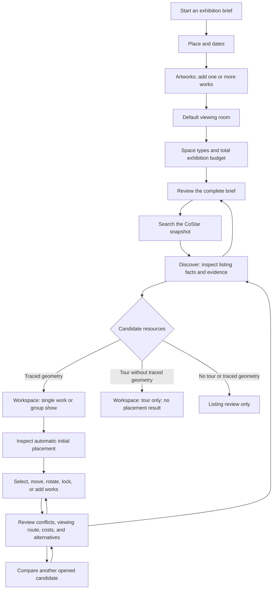

# ArtFit — Exhibition Planning User Flow

**Language:** English  
**Source baseline:** Local working tree at `/Users/hyeseung/work/artfit`, reviewed on November 14, 2026. Includes uncommitted changes.  
**Scope:** The implemented Brief → Discover → Workspace journey, including the group-show extension and clearly identified follow-up work.  
**Verification:** Source review. This document does not claim a new browser walkthrough or a passing application test run.

## 1. Product and user goal

ArtFit helps an artist or an exhibition organizer explore commercial-space listings and test an exhibition layout against traced spatial geometry.

For a group show, the organizer creates **one exhibition brief containing several artists' works**, searches candidate spaces, and opens selected candidates in the Workspace. The organizer can inspect suggested layouts, adjust individual works, set a viewing order, and track known and missing costs.

The product currently supports floor-standing works represented by their outer dimensions. A group show is a shared exhibition plan; it does not currently mean multiple people editing online together.

**Core journey:**

> Define one exhibition → add its artworks → search the CoStar snapshot → choose candidate spaces → inspect and revise the group layout → compare suggestions and unresolved conditions.

CoStar supplies listing information. Traced geometry supplies the basis for placement calculations. AI translates editing requests into supported actions. These roles must remain distinct.

## 2. Journey map

Returning to Discover after changing search-relevant dimensions shows a request to search again. Returning to another screen is not currently a durable save operation; see Section 10.

## 3. Screen 01 — Brief

### 3.1 Entry

The introduction offers **Begin your brief** and **Use example exhibition**. The example currently contains three works; it is sample input, not evidence about a venue.

The user completes six steps. One work and multiple works use the same onboarding flow.

| Step | User input or action | What carries forward |
| --- | --- | --- |
| 01 Place | Choose Houston or Los Angeles. | CoStar research market; not an exact municipal boundary. |
| 02 Dates | Enter opening and closing dates. | Requested exhibition period. Closing cannot precede opening. |
| 03 Artworks | Add, edit, or remove works. | Stable work IDs, titles, artist names, width, depth, and height. |
| 04 Room to walk | Set preferred clearance and an optional minimum. | Default viewing room around each work. |
| 05 Setting | Choose commercial-space types and enter an optional total exhibition budget. | Shared space preferences and total budget. |
| 06 Review | Review common conditions and every artwork; return to edit a step. | The complete brief submitted to search. |

### 3.2 Artworks and “+ Add artwork”

The Artworks step is an editable list, not a separate onboarding process for each artist.

Each row shows a title, artist, and dimensions. **Edit** opens the row's fields. **+ Add artwork** creates another work and opens it for editing. **Remove** is available when more than one work remains.

Current behavior:

- Width, depth, and height must be positive; dimensions are in meters.
- Title and artist name may be left blank during onboarding. The interface uses fallback labels.
- A newly added work starts with editable placeholder dimensions of 1 × 1 × 1.5 m and inherits the previous row's artist name. These defaults are not measured dimensions.
- The counter reports the number of works and distinct nonblank artist names. It is not an account or team-membership count.
- The combined footprint is the sum of width × depth. It is a reference value, not a required venue area or a group-fit verdict.
- The search endpoint currently accepts 1–12 works. Onboarding does not currently stop the user from adding a thirteenth work; the server rejects that request.

An artwork can begin as a dimensioned box. A custom 3D asset is not required to search. The current asset-upload implementation is available in the single-work editor; individual assets for every group work are not yet wired through the group renderer.

### 3.3 Shared and per-work requirements

Region, dates, space preferences, and total budget belong to the exhibition. Artist, title, real dimensions, required/optional status, and viewing-room exceptions belong to a work.

During onboarding, works default to required. Per-work viewing-room overrides and required/optional controls are available in the group Workspace. A null per-work clearance initially uses the brief's preferred clearance.

The optional minimum clearance is a user preference for possible compromises in the existing single-work alternatives flow. It is not a legal or safety minimum. The group planner does not automatically reduce every work's clearance to that minimum.

### 3.4 Review and submission

Review lists the work count, artist count, each work's dimensions, dates, market, viewing-room preferences, space types, and total budget.

Submitting calls `POST /api/spaces/search` with the brief. A successful response opens Discover. A failed search keeps the brief and displays an error.

The availability note explains that a marketed listing does not establish physical vacancy, an unfurnished condition, or readiness for an exhibition.

## 4. Screen 02 — Discover

### 4.1 What the search actually does

Search reads the locally loaded **November 2026 CoStar data-kit snapshot**. It is not a live CoStar inventory request or a venue-booking service.

The current candidate pipeline:

1. Select eligible marketed lease-space records in the chosen research market.
2. Apply supported space-use preferences. Unknown uses are counted separately for review rather than treated as confirmed matches.
3. Exclude lease-pending records and records with a reported availability date after the exhibition opening.
4. Retain relative or missing availability dates with their uncertainty visible. A missing date is not proof of availability.
5. Apply an advertised-area screen for ranking. The UI derives the legacy `artwork` field from the work with the largest width × depth.
6. Compare the tallest work with the property's listed ceiling height as ranking context.
7. Rank by area-screen category, listed-height context, long-idle signal, and time on market, with a stable ID tie-breaker.

The area and height screens do not remove candidates. The current area ranking puts the below-footprint category behind the other categories; it is not a complete ranking of group-layout quality. Property-level ceiling context can neither pass nor fail the local installation-height check.

**Important:** the area screen uses the largest-footprint work and the shared clearance preference. It does not pack all works, combine every per-work viewing requirement, or calculate a visitor route. The tallest work may be a different work from the largest-footprint work.

The budget is carried in the brief, but current search does not confirm that candidates fit the total exhibition budget. The snapshot does not supply a verified short-term exhibition quote.

### 4.2 What users see

The main summary uses readable descriptions such as **listings match your search** and **with linked 3D tours**. Internal stage names remain implementation details. Counts come from the search response, not fixed demo numbers.

For a group show, an explanation states how many works are in the exhibition, that the listing screen uses the largest work, and that the full group is checked in the studio.

The catalogue offers **All spaces**, **With a 3D tour**, and **Traced geometry**. Selection details explain exclusions, evidence gaps, and the snapshot date.

### 4.3 Opening the Workspace

| Candidate state | Available journey | What must not be implied |
| --- | --- | --- |
| Traced floor geometry exists | Open the placement studio. The featured section can open the traced candidates together. | Geometry exists does not mean it is reviewed or that the exhibition fits. |
| Linked Matterport tour, no traced geometry | Open a tour-only Workspace. | No calculated placement or verified exact-unit result. |
| Neither exists | Read listing facts in Discover. | No spatial placement capability for this candidate yet. |

Opening an individual traced card also includes other traced candidates from the current results for comparison. The clicked candidate opens first. A/B letters describe tab order, not permanent venue identities or quality rankings.

### 4.4 Four independent facts

| Fact | Supporting basis | Honest interpretation |
| --- | --- | --- |
| Marketed listing availability | Listing status and recorded availability information. | Offered in the snapshot; not confirmation of current physical conditions or booking permission. |
| Physical vacancy | Separate scoped, dated evidence. | Unknown unless supported; no tenant record is not vacancy evidence. |
| Furnished, unfurnished, or cleared condition | Separate reviewed observations or evidence. | A visually open scan does not establish the current state. |
| Spatial suitability | Correct unit-to-scan match, geometry review, scale/coverage checks, and the relevant calculation. | Separate from vacancy, furnishings, cost, and permission. |

The kit has no direct commercial-suite vacancy, furnishing, or cleared-state fields used to prove those conditions. A building-level Matterport association does not establish an exact-suite match. Strict verified-condition filters remain disabled in the current server validation.

## 5. Screen 03 — Workspace

### 5.1 Arrival and mode

The Workspace receives the brief and opened candidate IDs. It loads listing inspection data and traced geometry for each candidate.

- More than one work in the incoming brief opens **Group show** automatically.
- A one-work brief opens **Single work**.
- A mode switch remains available. The single-work editor is a separate editing path; it does not show the complete group calculation.
- Without traced geometry, a linked tour is view-only for planning purposes. Missing geometry never becomes a successful placement result.

In group mode, ArtFit attempts an initial placement when geometry is available. On later additions, it tries to place the new unplaced works while keeping already placed works fixed for that automatic attempt. It does not resize works to make them fit. Unplaced works remain in the list and are reported.

### 5.2 Left panel — Works

The works list identifies each work by title and artist and shows its real dimensions, optional status, lock status, and whether it is placed. Artist colors help distinguish works; the current list is flat rather than organized into collapsible artist sections.

Selecting a work exposes:

- Real dimensions, which only the user edits in group mode.
- Per-work viewing-room distance and **Must be in the show**.
- Camera-relative 10 cm nudges and 15° rotation controls for placed works.
- **Lock position**, scoped to the current candidate space.
- Explicit removal with confirmation.

**Add a work** is also available here. Unlike onboarding, the current Workspace add form requires a title and artist name. Deleting a work removes its associated poses, locks, order entry, and linked cost items from the group document.

### 5.3 Center — Spatial views

Three modes are available: **3D planning view**, **Side by side**, and **Original Matterport scan**.

The planning view reconstructs traced geometry. Group works and the calculated route can also be overlaid in the Matterport scene when the integration is available. The baked scan itself is not rewritten.

The current scenario is **as scanned**. Permanent obstacles, movable furniture, and uncertain objects present in the annotations remain blockers. The app must not silently remove a scanned object or infer that a venue is cleared. Missing or partial obstacle annotation remains an evidence limitation.

Switching candidate tabs during the same mounted Workspace keeps separate poses and locks for each space. Works and their dimensions are shared across those candidates. The viewing order is shared too.

### 5.4 Right panel — Review and decide

The group review panel currently presents:

1. Placement issues and the number of works placed.
2. A per-artist summary of works with viewing room.
3. Viewing route and controls to move works earlier or later in the order.
4. Suggested layouts and their tradeoffs.
5. **The same show elsewhere** checks for other opened candidates.
6. Quoted, estimated, and unknown costs against the total budget.

The current headline remains provisional: a draft-layout result is not a verified venue recommendation. The group panel currently labels geometry as draft/review pending rather than deriving a complete evidence-based group verdict.

## 6. What group placement and route calculations mean

### 6.1 Placement checks

The engine checks each placed work against the floor boundary, active blockers, and the bodies of the other placed works. It reports required works without a pose.

Viewing zones may overlap one another. Another artwork's body must not occupy the requested viewing space. Shared viewing space avoids counting every surrounding buffer as an exclusive area.

The group suggestion engine currently samples a 0.3 m placement grid at 0° and 90° and uses randomized greedy restarts with a seeded generator. These settings differ from the single-work search. A layout is a suggestion among tested arrangements, not a mathematical global optimum. Failure to find one is not proof that none exists.

### 6.2 Route preview

The route uses a 0.2 m grid, annotated blockers, artwork footprints, and a 0.25 m body-radius assumption. It starts near the first traced entrance zone, visits computed standing points in the requested order, and returns to that entrance. It does not discover or validate a separate exit.

Entrance zones block artwork placement but are traversable for route construction. Without a traced or connected entrance, the route is unavailable and an explanation is returned.

The result is a connectivity preview. It does not establish crowd capacity, accessibility compliance, egress compliance, or load-in feasibility.

**Current implementation caveat:** when no route can be computed, per-work reachability can be `null`. `evaluateGroup().ok` accepts reachability that is not explicitly false. Therefore an otherwise conflict-free result can coexist with an unknown route. The present success copy must not be interpreted as proof that every work is reachable; tightening this behavior is follow-up work.

### 6.3 Layout alternatives

The group planner can suggest:

- **Most room around each work**.
- **Follows your viewing order**.
- **Fewest changes to the current layout**, when a movable current layout exists.

Cards show required/total placement counts, spare room, route length when available, changes, and works that could not be placed. Optional works can remain unplaced; they are not deleted from the exhibition. An incomplete suggestion must remain visibly incomplete.

**Use this layout** applies a suggestion as one undoable change. Editing the group document marks existing suggestion cards stale and disables applying them until suggestions are regenerated.

**The same show elsewhere** performs a fresh group search with the same work specifications and viewing order. It ignores current-space poses and locks. It currently returns a summary; it does not save that tested alternative as the other space's layout or calculate a venue-specific budget comparison.

The existing single-work alternative service is separate: it compares another space at the same requirement with the original space at a reduced preferred clearance, only when the user specified an acceptable minimum. It must not be presented as a group-layout solver.

## 7. AI inside the Workspace

The primary journey begins with the brief. Workspace AI helps edit the exhibition after candidate selection; it does not need to lead the homepage experience.

| Context | Supported behavior | Boundary |
| --- | --- | --- |
| Group show | Lock/unlock works, change order, request rearrangement, move, rotate, change viewing room, select, undo, redo. | No group resize, deletion, elevation, or material operation. |
| Single work | Supported position, rotation, size, elevation, and finish edits. | A separate editor; elevated previews do not certify suspension or support. |
| Search agent service | `search_spaces`, `inspect_space`, `evaluate_placement`, `plan_alternatives`. | A separate four-tool service, not the group editor or a group optimization engine. |

Example group requests:

> “Lock Work 1 and rearrange the rest.”  
> “Show Work 2 first, then Work 1.”  
> “Move Work 3 left 30 cm.”

Claude returns supported structured operations. ArtFit resolves units, preserves locks and dimensions, applies operations in code, and re-evaluates the group. Individual moves can reveal conflicts; applying a command is not a guarantee that it creates a valid layout.

An unsupported or ambiguous request produces an explanation or clarification instead of an invented operation. Replies are skipped if the active space or group version changed while AI was working. An applied request is one undoable step. The current AI rearrange path rejects a suggestion that cannot place every required work.

If AI is unavailable, manual panels and layout suggestions remain usable. AI cannot change listing facts, evidence, floor boundaries, or permanent obstacles.

## 8. Budget behavior

The brief's amount is the **total exhibition budget**, including venue, transport, installation, and other entered costs. Group Workspace starts with an unknown short-term venue-rental cost; it does not import an invented quote from asking rent.

Users add costs, enter amounts, and label them **Quoted**, **My estimate**, or **Unknown**. These are user-entered statuses, not independently authenticated quotes.

- Quoted amounts and estimates are reported separately.
- Unknown items prevent a complete within-budget conclusion; unknown is not treated as a confirmed zero.
- Quoted costs alone above budget trigger an over-budget result.
- A complete within-budget result requires all entered items to be quoted in a consistent currency.
- Currency mismatch produces an unknown result. It is not an exchange-rate conversion.
- An annual per-square-foot asking rate is not a short-term venue price.

Current placement suggestions do not use cost as an optimization objective. Moving works does not change entered costs. The cost list is shared across opened spaces, not a set of separate venue-specific quotes. The product can currently support planning **with budget visibility**, not promise an optimized layout **within a verified budget**.

## 9. Data handoff and application state

These are existing ArtFit internal contracts and routes, not invented CoStar or Matterport fields.

| Boundary | Current data and behavior |
| --- | --- |
| Brief → search | `ExhibitionBrief` includes common requirements, optional `works[]`, and legacy `artwork`. `withWorks()` derives `artwork` from the largest-footprint work. |
| Per-work input | `BriefWork`: `id`, `title`, `artist`, `widthM`, `depthM`, `heightM`, `clearanceM`, `required`. |
| Search → Discover | Search response contains normalized candidates, evidence labels, runtime funnel counts, and area/height context. |
| Discover → Workspace | The application retains the brief and supplies selected `spaceIds`; inspection and geometry are fetched for each candidate. |
| Group editing | `GroupDoc` contains shared works, viewing order, costs, budget/currency, and `bySpace` poses/locks. |
| AI group editing | `POST /api/workspace/group-edit` interprets an instruction; the browser applies the operations to the current group document. |
| Group → Brief | Group work-list edits are copied back through `withWorks()` when the group synchronization effect runs. This is not persistence of the entire group document. |

The existing stale-search fingerprint tracks market, dates, space-use preferences, legacy artwork, preferred/minimum clearance, and work dimensions. It does not track every group property or budget. This is a specific invalidation mechanism, not a complete project-revision system.

The normal screen flow is managed by application state. It is not a set of durable saved-project URLs. `/annotate/:spaceId` is a separate internal review route.

## 10. Current gaps and required follow-up

The items below are deliberately separated from the implemented flow. They should not be demonstrated as finished behavior.

| Area | Current behavior or limitation | Follow-up requirement |
| --- | --- | --- |
| Route certainty | Unknown reachability can coexist with `ok=true` and positive headline copy. | Separate placement and route outcomes; keep an unavailable route visibly unknown. |
| Group height | Tallest-work height affects Discover ranking, but `evaluateGroup()` does not perform per-work local ceiling checks. | Add independent local-height checks and unknown states for group works. |
| Venue budget | Costs are shared, user-entered, and do not constrain suggestions. | Store scoped quotes per candidate and calculate supported cost differences before claiming budget-aware optimization. |
| Persistence | App/Workspace documents are held in component state. Leaving Workspace unmounts it; group poses, costs, order, locks, and history are not durably saved. | Persist a complete exhibition project and restore it across navigation/reload. Do not promise restoration today. |
| Brief synchronization | Work specifications sync back; Workspace budget, costs, route order, and poses do not all sync into the brief. | Define a single project source of truth and test round trips. |
| Switching modes | Single-work state and group state use different editing paths. | Verify size/identity synchronization before promising seamless switching. |
| Group artwork assets | The group renderer uses dimensioned work geometry; per-work image/GLB assets are not connected. | Add per-work assets to both renderers. Correct onboarding's generic asset promise until then. |
| Onboarding limit | Search accepts at most 12 works; the add button has no matching limit. | Explain/enforce the limit before submission. |
| Evidence status | Group review currently uses a draft/review-pending presentation rather than the complete spatial verification model. | Derive evidence status separately from the computed layout result. |
| Comparison summaries | “Elsewhere” checks are temporary summaries rather than saved alternate layouts. | Store results with a revision and invalidate them after relevant edits. |
| Physical conditions | Strict verified-condition filters and hypothetical furniture removal are disabled. | Enable only with supported evidence and explicit scenario handling. |

### Preferred Workspace layout — agreed direction, not current implementation

The selected design direction is a **bottom dock that reserves its own layout space below the viewer**. Left and right panels should collapse and support bounded resizing; the dock should expand for editing and collapse for inspection. Keep controls opaque and readable rather than relying on transparency over a detailed scan.

The current desktop implementation still places the panels and AI dock over the canvas. Panels can hide/reopen, but drag resizing and a collapsible, space-reserving dock are not implemented. The planning camera has inset compensation; that does not make the layout equivalent to an unobstructed viewer. Smaller layouts move panels and the dock into normal document flow.

## 11. Demonstration walkthrough

Use actual loaded candidates and observed results. Do not hardcode candidate counts, successful placements, route lengths, or cost claims.

1. Start a brief and choose the supported research market and exhibition dates.
2. Add three measured floor-standing works by two or three artists using **+ Add artwork**.
3. Set shared viewing room, space preferences, and the total exhibition budget. Review all three works.
4. Search the snapshot. Explain that largest-work area and tallest-work height are preliminary screens.
5. Open a candidate with traced geometry. State whether the geometry and exact-suite match are reviewed.
6. Inspect automatic group placement. Keep any unplaced required work or reported conflict visible.
7. Select and lock one placed work. Ask AI to rearrange the rest, or use manual suggestions if AI is unavailable.
8. Change the viewing order and inspect the route. If unavailable, show the reason rather than drawing a fictional path.
9. Compare the available layout priorities and apply one. Use Undo to demonstrate reversibility.
10. Check another opened space using the same work specifications. Explain that this is a fresh sampled layout check, not an automatic booking or a verified budget comparison.
11. Show quoted, estimated, and unknown costs. Finish with the actual unresolved checks: exact-unit match, geometry, local height, physical conditions, dates, permission, load-in, and the venue quote as applicable.

## 12. Verification checklist

This is a review/acceptance checklist, not a statement that the checks have just passed.

- Add two works to onboarding, edit dimensions, remove one, and confirm Review and the search payload retain the correct work IDs and specifications.
- Confirm a multi-work brief opens Group show and starts without fabricated cost quotes.
- Confirm area screening uses the largest footprint while height context uses the tallest work, including when they are different works.
- Check listing exclusions, missing dates, readable counts, and the tour-only path.
- Check initial placement, adding a new work, explicit unplaced-work reporting, and preservation of already placed works during the automatic addition attempt.
- Check body collisions, shared viewing zones, required works, locks, and manual edits.
- Check route order, unreachable standing points, absent entrances, and the independent presentation of unknown reachability.
- Check suggested-layout invalidation, Undo/Redo, and rejection of stale AI replies.
- Check costs with unknown items, estimates, over-budget quotes, and currency mismatch.
- Check navigation away from Workspace and reload without assuming unsaved group state survives.
- Confirm actual viewport behavior before claiming that the dock or panels leave the viewer unobstructed.

Existing test sources cover parts of these rules: `geometry/test/group.test.ts`, `server/test/groupEdit.test.ts`, `server/test/briefWorks.test.ts`, and `server/test/searchFit.test.ts`. Their presence does not substitute for testing the complete browser journey.

## 13. Source map

Paths below are relative to the ArtFit repository root. The document records a working-tree snapshot; source may change afterward.

| Source | Behavior inspected |
| --- | --- |
| `web/src/App.tsx` | Screen state, brief/search handoff, stale-search key, selected candidate IDs, conditional Workspace mounting. |
| `web/src/screens/Brief.tsx` | Six-step onboarding, `worksOf`, `largestWork`, `withWorks`, work list, review, total budget copy. |
| `web/src/screens/Discover.tsx` | Runtime summaries, group-screening explanation, filters, traced candidates, tour-only entry. |
| `web/src/screens/Workspace.tsx` | Auto-selected group mode, candidate loading, views, work synchronization, panel visibility, AI integration. |
| `web/src/workspace/GroupStudio.tsx` | Group document/history, work controls, automatic placement, layout suggestions, route order, budget input, group AI operations. |
| `web/src/workspace/ArtworkEditBar.tsx` | Separate single-work AI edit interface. |
| `web/src/styles.css` | Current floating desktop panels/dock and smaller-screen flow layout. |
| `geometry/src/types.ts` | Existing `BriefWork` and `ExhibitionBrief` contracts. |
| `geometry/src/group.ts` | Group placement, shared viewing room, route preview, suggestion priorities, budget summary. |
| `server/src/agent/tools.ts` | Brief validation, 1–12-work limit, snapshot candidate selection, area/height ranking, existing single-work alternatives. |
| `server/src/agent/groupEdit.ts` | Group AI operation allowlist and interpretation. |
| `server/src/agent/loop.ts` | Separate four-tool search agent. |
| `server/src/index.ts` | Existing search, inspection, geometry, placement, agent, and Workspace edit routes. |
| `web/src/main.tsx` | App routing and separate annotation route. |

